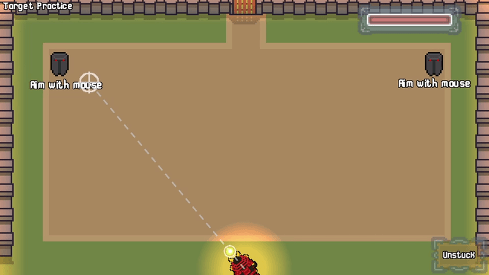

# Orb Samurai

**Samurai vs. a castle of knights. Catch the orb, aim your deflect, survive.**

Orb Samurai is a Breakout-inspired arcade action game. You play a samurai raiding a castle full of knights. Instead of just bouncing the orb back, you **deflect it toward your crosshair**, so every catch is also an aim. Move to catch it, aim to hit the enemies.

### [▶ Play it on itch.io](https://dev-bakery.itch.io/orb-samurai)

Free to play in your browser, with Windows and Linux downloads available. Best played with a mouse.



## Features

- 13 levels, from daylight to nightfall as you push deeper into the castle
- Aim-your-deflect gameplay: the orb flies toward your mouse crosshair
- Four enemy types, plus a boss fight against an elite archer who aims right at you
- A hidden challenge level for anyone who beats the campaign
- Automatic progress saving
- Pixel art, hit sparks, an orb trail and 2D lighting

## How to play

| Action | Control |
| --- | --- |
| Move | `A` / `D` |
| Aim | Mouse |
| Deflect | Catch the orb. It flies toward your crosshair |

You have **100 HP** each level. Missing the orb costs **25 HP**, and arrows deal **10 HP**. If you lose, you can retry the level until you win.

## Enemies

| Enemy | Behavior |
| --- | --- |
| Knight | Goes down in 1 hit |
| Sword Knight | Takes 2 hits. The first hit bounces the orb back faster |
| Shield Knight | Takes 3 hits |
| Archer | Fires an arrow straight down every 3 seconds |
| Elite Archer (boss) | Fires every second, aiming at the player |

## Saving

Progress is saved automatically after each level. The browser version stores progress in your browser, so it resets if you clear site data or play in a private window. The downloadable versions save to your computer.

## Download

Get the latest builds from the [itch.io page](https://dev-bakery.itch.io/orb-samurai):

- Web (play in browser)
- Windows
- Linux

## Building from source

1. Install [Godot 4](https://godotengine.org/download).
2. Clone this repository:
   ```
   git clone https://github.com/kenji-adachi/orb-samurai.git
   ```
3. Open the project in Godot by importing `project.godot`.
4. Press **F5** to run.

To export, install the export templates (Editor > Manage Export Templates), then use Project > Export. For the web build, name the export file `index.html`.

## About the project

Orb Samurai is game 2 of my **20 game challenge**, where I recreate 20 popular games. It started as a straight Breakout clone, then turned into its own thing.

- Game 1: Pong
- Game 2: Orb Samurai (this one)

## Credits

Made by **Dev Bakery**, built with [Godot](https://godotengine.org/).

## License

MIT
